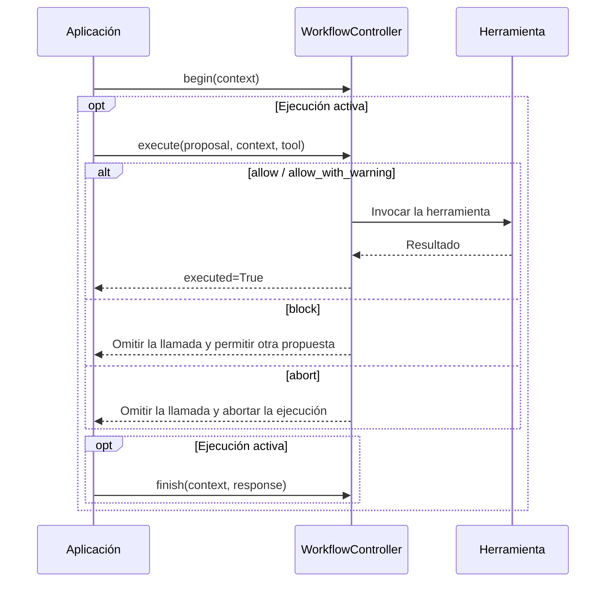

<!-- Copyright (c) 2026 Jorge Carlos Urteaga Reyesvera
SPDX-License-Identifier: Apache-2.0 -->

# Vogtcon

[English](README.md) · Español

Vogtcon es una biblioteca experimental de Python que comprueba si las llamadas a herramientas que propone un agente cumplen un contrato YAML. Por ejemplo, el agente puede pedir que se envíe una notificación sensible, pero la aplicación determina si hay aprobación. Vogtcon evalúa las reglas antes de invocar la herramienta. Su evaluador predeterminado es determinista y funciona con independencia de la biblioteca usada para crear el agente.

## Instalación

Requiere Python 3.11 o posterior. Instala la biblioteca desde PyPI con `python -m pip install vogtcon`. Si tu aplicación usa Pydantic AI, instala las dependencias opcionales con `python -m pip install "vogtcon[pydantic-ai]"`.

## Validar un contrato

Desde un directorio que contenga un contrato de Vogtcon, ejecuta `vogtcon validate contrato.yaml`. Agrega `--json` para obtener una salida estructurada en scripts o CI.

## Probar la integración

Desde la raíz del repositorio clonado, ejecuta el ejemplo que guarda notas. Utiliza un modelo con respuestas programadas y funciona sin credenciales de un proveedor.

```bash
uv sync --locked --extra pydantic-ai --group test
uv run --no-sync python examples/custom_agent.py --log note-events.jsonl
```

El agente solicita dos veces que se guarde la misma nota pública. Observa los campos `decision` y `saved` de la salida.

| Aprobación de la aplicación | Decisión | Efecto |
| --- | --- | --- |
| `False` | `block` | La lista de notas guardadas queda vacía. |
| `True` | `allow` | La lista contiene una nota pública. |

El ejemplo añade las decisiones de cada ejecución a `note-events.jsonl`. Agrega `--trace-console` al segundo comando para ver las trazas de OpenTelemetry. [Código del ejemplo](examples/custom_agent.py) · [Contrato de las notas](examples/custom_contract.yaml)

## Conectar una herramienta

Crea un `WorkflowController` por ejecución. Llama a `begin` antes de iniciar el agente, pasa cada propuesta de uso de una herramienta a `execute` y llama a `finish` con la respuesta final de la aplicación mientras el controlador siga en estado `active`. Si expones una herramienta directamente al agente, sus llamadas quedan fuera de estas comprobaciones.

Este ejemplo se ejecuta desde la raíz del repositorio y solo requiere el paquete principal. Imprime `block []` porque la notificación es sensible y la aplicación no ha concedido la aprobación. [Contrato de notificaciones](examples/notification_contract_v2.yaml)

```python
from vogtcon import ActionProposal, EnforcementPolicy, ExecutionContext, WorkflowController

controller = WorkflowController.from_contract_path(
    "examples/notification_contract_v2.yaml",
    run_id="notification-1",
    policy=EnforcementPolicy(mode="guarded"),
)
context = ExecutionContext(
    state={"approval_granted": False},
    available_tools=["send_notification"],
    observed_agent_fingerprint="notification-agent-v1",
    observed_contract_fingerprint=controller.contract.contract_fingerprint,
)
sent = []

def send_notification(proposal: ActionProposal) -> None:
    sent.append(proposal.arguments["message"])

controller.begin(context)
if controller.state == "active":
    proposal = ActionProposal(
        tool_name="send_notification",
        arguments={"message": "Hello", "sensitive": True},
    )
    outcome = controller.execute(proposal, context, send_notification)
    print(outcome.decision.decision, sent)
    if controller.state == "active":
        controller.finish(context, {"status": "sent" if outcome.executed else "blocked"})
```

Para simplificar el ejemplo, la huella del contrato se toma del propio YAML. Al integrarlo en tu aplicación, obtén la identidad observada, los roles y las aprobaciones de fuentes de confianza. Trata las afirmaciones del modelo como datos sin verificar. En el ejemplo de las notas, la aplicación calcula `verified_output` a partir de lo que guardó la herramienta.

### Ciclo de vida de la ejecución



## Elegir el modo de ejecución

El contrato v2 define las reglas. La aplicación debe indicar una `EnforcementPolicy` en cada ejecución. Los [contratos v1](examples/notification_contract.yaml) guardan el modo en el YAML y se pueden cargar sin pasar una política por separado.

| Modo | Decisión ante una propuesta de uso de herramienta | Qué ocurre después |
| --- | --- | --- |
| `no_contract` | `allow` sin evaluar las reglas | Se invoca la herramienta. Este modo sirve de referencia para experimentos. |
| `advisory` | `allow_with_warning` si se infringe una regla | Se invoca la herramienta y la decisión indica la infracción. |
| `guarded` | `block` si se infringe una regla | Se omite la llamada y el agente puede proponer otra acción. |
| `strict` | `abort` si se infringe una regla | Se omite la llamada y la ejecución termina en estado `aborted`. |

Consulta `controller.state` después de `begin` y de cada llamada a `execute`. En modo estricto, una infracción al inicio también aborta la ejecución. Si `finish` detecta una infracción, el estado pasa a `failed_post`. Los efectos ya producidos se conservan.

## Registro de decisiones y trazas

Pasa `recorder=JsonlDecisionLog(path)` al crear el controlador para registrar las decisiones en un archivo JSONL local. El controlador escribe la decisión en disco antes de invocar la herramienta. Si la escritura falla, se omite la llamada. Si la propia herramienta lanza una excepción, sus efectos pueden quedar sin confirmar. El registro está pensado para ejecuciones secuenciales en un solo proceso.

Para obtener trazas, pasa un `TelemetryObserver` al controlador y envuelve la ejecución en `with telemetry.run(run_id, contract_id)`. La aplicación configura el exportador de OpenTelemetry. El campo `trace_id` vincula cada traza con sus registros de decisión. Para definir reglas con `RuleCatalog` o usar `GovernedToolExecutor` cuando tu aplicación ya gestiona el ciclo de ejecución, consulta la [guía de integración](INTEGRACION.md).

## Más ejemplos

- **Generación aumentada por recuperación (RAG) con LangChain.** El agente recupera documentos de un índice vectorial en memoria y aplica el contrato antes de publicar un informe. El entorno de referencia usa Linux x86_64, Python 3.12 y PyTorch para CPU. En un Mac con procesador Intel, usa Docker o Podman para ejecutar el agente con contrato, la versión de referencia y las pruebas con los comandos de abajo. La primera compilación descarga las dependencias y el modelo. Después, el contenedor funciona sin conexión. [Agente](examples/langchain_rag_agent.py) · [Dependencias fijadas](examples/requirements-langchain-rag.txt) · [Reporte](examples/REPORTE_LANGCHAIN_RAG.md)
- **Facturación electrónica mexicana (CFDI).** El ejemplo concilia facturas y movimientos bancarios sintéticos con registros locales. Funciona sin conexión y muestra cómo aplicar las reglas de la aplicación. La validación fiscal y las consultas al SAT quedan fuera de su alcance. [Agente](examples/cfdi_agent.py) · [Dependencias](examples/requirements-cfdi.txt) · [Reporte](examples/REPORTE_CFDI_SAT.md)

```bash
bash scripts/run_rag.sh --container governed
bash scripts/run_rag.sh --container pre
bash scripts/run_rag.sh --container test
```

## Desarrollo y pruebas

Después de preparar el entorno con el comando `uv sync` anterior, ejecuta las pruebas del controlador y comprueba que otro entorno pueda instalar y usar el paquete en formato wheel.

```bash
uv run --no-sync python -m unittest discover -s tests -p 'test_execution.py'
sh tests/smoke_wheel_consumer.sh
```

Las pruebas que dependen del repositorio de evaluación lo localizan mediante `GOVERNOR_BENCHMARK_ROOT`. El piloto exploratorio abarca los escenarios `S-001`, `S-013` y `S-016` en los cuatro modos. El [programa del piloto](pilots/benchmark_probe.py) realiza cuatro ejecuciones por defecto y acepta `--scenarios` y `--modes` para seleccionar las doce. Las diferencias entre el manifiesto y la copia del repositorio limitan las comparaciones históricas.

Las pruebas automáticas usan modelos con respuestas programadas. El paquete carece de un registro distribuido y de un evaluador basado en un modelo de lenguaje. Los reportes históricos usan el nombre anterior `governor_contracts`.

## Licencia

[Licencia Apache 2.0](LICENSE)
