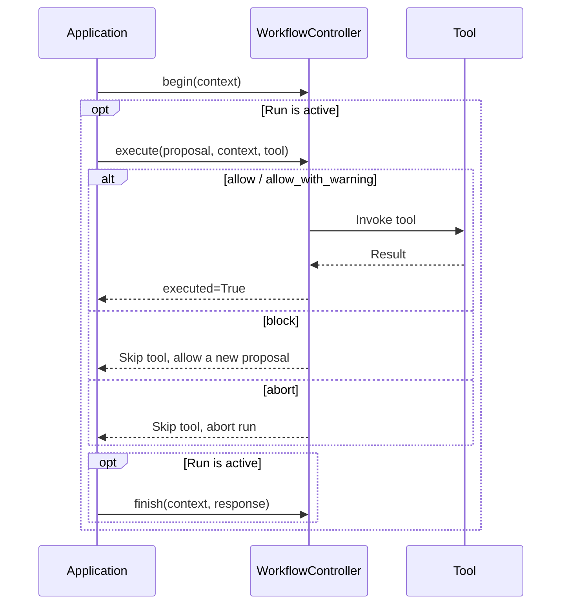

<!-- Copyright (c) 2026 Jorge Carlos Urteaga Reyesvera
SPDX-License-Identifier: Apache-2.0 -->

# Vogtcon

English · [Español](https://github.com/CarlosUrteaga/vogtcon/blob/main/README.es.md)

Vogtcon is an experimental Python library that checks an agent’s proposed tool calls against a YAML contract. For example, an agent can ask to send a sensitive notification, but the application decides whether approval has been granted. Vogtcon evaluates the rules before calling the tool. Its default evaluator is deterministic and works independently of the agent framework.

## Installation

Requires Python 3.11 or later. Install the core library from PyPI with `python -m pip install vogtcon`. For a Pydantic AI application, install the optional extra with `python -m pip install "vogtcon[pydantic-ai]"`.

<a name="probar-la-integración"></a>

## Command-line interface

Vogtcon provides a local, read-only, offline CLI (`vogtcon --help`, `vogtcon --version`) for validating contracts and explaining decision logs without invoking models, executing tools, or making network requests:

```bash
vogtcon validate contract.yaml
vogtcon explain decisions.jsonl
```

Optional flags: pass `--json` to either command for structured JSON output, and `--run-id <run-id>` to `vogtcon explain` to inspect a single run (for example, `vogtcon explain decisions.jsonl --run-id demo-run --json`).

- **Human-readable vs. JSON output.** Without `--json`, results are written to `stdout` and errors to `stderr`; human-readable text is not a stable API. With `--json`, valid invocations emit a single JSON object (`output_version: 1`) on `stdout`—including on validation, log, or I/O errors—with no extra diagnostic text. Invalid CLI syntax writes usage to `stderr`, leaves `stdout` empty, and exits with `3`.
- **`vogtcon validate`** validates a v1 or v2 contract YAML file against the default `RuleCatalog`. A valid v2 contract reports a verified fingerprint (`verified: true`); a v1 contract reports its declared fingerprint as `verified: false` (including `no_contract` with `validation_phases: "not_enforced"`).
- **`vogtcon explain`** parses every non-empty line in a UTF-8 JSONL log as a `RunEvent` v1 record, preserves physical event order per run, correlates actions by `(run_id, action_index)`, and reports `trace_integrity` (`complete`, `partial`, or `inconsistent`). When `--run-id` is passed, line-level format validation still applies to the entire file.

### Exit codes

| Code | `vogtcon validate` | `vogtcon explain` |
| --- | --- | --- |
| `0` | `valid` — contract is valid. | `ok` — coherent `complete` or `partial` log (including `block`, `abort`, `allow_with_warning`, `tool_error`, or missing checkpoints/finalizers). |
| `1` | `invalid_contract` — malformed YAML/JSON, unsupported version, schema mismatch, missing phases, or v2 fingerprint mismatch. | `invalid_log` (empty file, invalid UTF-8, or invalid `RunEvent` line) or `inconsistent_log` (semantic contradiction in a selected run). |
| `2` | `unsupported_rules` — rule ID outside the default `RuleCatalog` (requires a host-supplied `RuleCatalog`). | `run_not_found` — requested `--run-id` is absent from an otherwise valid log. |
| `3` | `io_error` (file missing or unreadable) or invalid CLI usage. | `io_error` (file missing or unreadable) or invalid CLI usage. |

### Evidence scope

`vogtcon explain` reports only what the `RunEvent` v1 log proves:

- `RunEvent` v1 logs are content-free: they contain no tool arguments, tool results, prompts, or host approval grants.
- A subsequent `allow` (or `allow_with_warning`) on the same `tool_name` (`prior_same_tool_block_action_index`) only indicates an earlier `block` on that tool name; it does **not** prove identical arguments or host authorization.
- Blocked (`block`) and aborted (`pre_abort` / `runtime_abort`) actions omit a tool finalizer by design (`effect_evidence: "prevented_by_recorded_decision"`).
- `tool_completed` confirms only that the callable returned (`effect_evidence: "not_verified"` for external delivery).
- `tool_error`, or a missing finalizer when the recorded decision allowed the action (`allow` or `allow_with_warning`), leaves the external effect `indeterminate`.

## Try the integration

From the root of a clone, run the note-saving example with a scripted model. It works without provider credentials.

```bash
uv sync --locked --extra pydantic-ai --group test
uv run --no-sync python examples/custom_agent.py --log note-events.jsonl
```

The agent asks to save the same public note twice. Look at `decision` and `saved` in the output.

| Approval supplied by the application | Decision | Effect |
| --- | --- | --- |
| `False` | `block` | The list of saved notes stays empty. |
| `True` | `allow` | The list contains one public note. |

The demo appends each run’s decisions to `note-events.jsonl`. Add `--trace-console` to the second command to see OpenTelemetry spans. [Example code](https://github.com/CarlosUrteaga/vogtcon/blob/main/examples/custom_agent.py) · [Note contract](https://github.com/CarlosUrteaga/vogtcon/blob/main/examples/custom_contract.yaml)

## Connect a tool

Create one `WorkflowController` per run. Call `begin` before starting the agent, route each proposed tool call through `execute`, and call `finish` with the application’s final response while the controller is still `active`. A tool exposed directly to the agent bypasses these checks.

This example runs from the repository root with only the core package installed. It prints `block []` because the notification is sensitive and the application has supplied no approval. [Notification contract](https://github.com/CarlosUrteaga/vogtcon/blob/main/examples/notification_contract_v2.yaml)

```python
from vogtcon import ActionProposal, EnforcementPolicy, ExecutionContext, WorkflowController

controller = WorkflowController.from_contract_path(
    "examples/notification_contract_v2.yaml",
    run_id="notification-1",
    policy=EnforcementPolicy(mode="guarded"),
)
context = ExecutionContext(
    state={"approval_granted": False},
    available_tools=["send_notification"],
    observed_agent_fingerprint="notification-agent-v1",
    observed_contract_fingerprint=controller.contract.contract_fingerprint,
)
sent = []

def send_notification(proposal: ActionProposal) -> None:
    sent.append(proposal.arguments["message"])

controller.begin(context)
if controller.state == "active":
    proposal = ActionProposal(
        tool_name="send_notification",
        arguments={"message": "Hello", "sensitive": True},
    )
    outcome = controller.execute(proposal, context, send_notification)
    print(outcome.decision.decision, sent)
    if controller.state == "active":
        controller.finish(context, {"status": "sent" if outcome.executed else "blocked"})
```

The example copies the contract fingerprint from the YAML for convenience. In an integration, obtain the observed identity, roles and approvals from trusted application sources. Treat the model’s claims as untrusted. The note example computes `verified_output` from what the tool actually saved.

### Execution lifecycle



## Choose an enforcement mode

A v2 contract defines the rules. The application must supply an explicit `EnforcementPolicy` for each run. A [v1 contract](https://github.com/CarlosUrteaga/vogtcon/blob/main/examples/notification_contract.yaml) stores the mode in its YAML and can be loaded without a separate policy.

| Mode | Decision on a proposed tool call | What happens next |
| --- | --- | --- |
| `no_contract` | `allow` without evaluating the rules | The tool runs. This mode provides an experimental baseline. |
| `advisory` | `allow_with_warning` on a violation | The tool runs and the decision reports the violation. |
| `guarded` | `block` on a violation | The tool is skipped and the agent can propose another action. |
| `strict` | `abort` on a violation | The tool is skipped and the run ends in `aborted`. |

Check `controller.state` after `begin` and each `execute`. In strict mode, a pre-execution violation also aborts the run. A violation at `finish` sets the state to `failed_post`. Effects that have already occurred remain in place.

## Decision logs and traces

Pass `recorder=JsonlDecisionLog(path)` when creating the controller to record decisions in a local JSONL file. The controller writes the decision to disk before invoking the tool. If that write fails, the tool is skipped. If the tool itself raises an exception, its effects may be unknown. The log is designed for sequential runs in one process.

For tracing, pass a `TelemetryObserver` to the controller and wrap the run in `with telemetry.run(run_id, contract_id)`. The application configures the OpenTelemetry exporter. The `trace_id` connects spans with decision records. For custom rules with `RuleCatalog` or applications that already manage their own lifecycle with `GovernedToolExecutor`, see the [integration guide (Spanish)](https://github.com/CarlosUrteaga/vogtcon/blob/main/INTEGRACION.md).

## More examples

- **Retrieval-augmented generation (RAG) with LangChain.** The agent retrieves documents from an in-memory vector store and applies the contract before publishing a brief. The reference environment uses Linux x86_64, Python 3.12 and CPU PyTorch. On Intel macOS, use Docker or Podman to run the governed agent, the baseline and the tests with the commands below. The first build downloads dependencies and the model. The container then runs offline. [Agent](https://github.com/CarlosUrteaga/vogtcon/blob/main/examples/langchain_rag_agent.py) · [Dependency lock](https://github.com/CarlosUrteaga/vogtcon/blob/main/examples/requirements-langchain-rag.txt) · [Report (Spanish)](https://github.com/CarlosUrteaga/vogtcon/blob/main/examples/REPORTE_LANGCHAIN_RAG.md)
- **Mexican electronic invoices (CFDI).** The example reconciles synthetic invoices and bank transactions against local records. It runs offline and demonstrates application policy. Tax validation and queries to Mexico’s tax authority (SAT) are outside its scope. [Agent](https://github.com/CarlosUrteaga/vogtcon/blob/main/examples/cfdi_agent.py) · [Dependencies](https://github.com/CarlosUrteaga/vogtcon/blob/main/examples/requirements-cfdi.txt) · [Report (Spanish)](https://github.com/CarlosUrteaga/vogtcon/blob/main/examples/REPORTE_CFDI_SAT.md)

```bash
bash scripts/run_rag.sh --container governed
bash scripts/run_rag.sh --container pre
bash scripts/run_rag.sh --container test
```

## Development and tests

After setting up the checkout with the `uv sync` command above, run the controller tests and run `sh tests/smoke_wheel_consumer.sh` to verify in a separate environment both the Python wheel consumer and the installed `vogtcon validate` and `vogtcon explain` CLI commands.

```bash
uv run --no-sync python -m unittest discover -s tests -p 'test_execution.py'
sh tests/smoke_wheel_consumer.sh
```

Benchmark-dependent tests use `GOVERNOR_BENCHMARK_ROOT` to locate a local benchmark checkout. The exploratory pilot covers scenarios `S-001`, `S-013` and `S-016` across all four modes. The [pilot script](https://github.com/CarlosUrteaga/vogtcon/blob/main/pilots/benchmark_probe.py) defaults to four runs and accepts `--scenarios` and `--modes` for the twelve-run selection. Differences between the manifest and the checkout limit historical comparisons.

Automated tests use scripted models, and the package provides neither a distributed ledger nor an LLM-based Governor. Older reports use the former name `governor_contracts`.

## License

[Apache License 2.0](https://github.com/CarlosUrteaga/vogtcon/blob/main/LICENSE)
